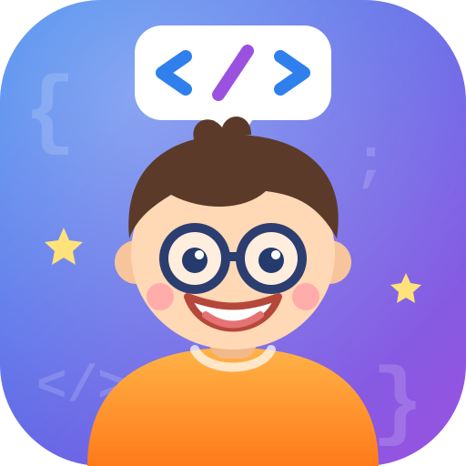

<div align="center">



# Code for Kids

**Learn to code by playing · Apprendre à programmer en jouant**

[](https://sockese.github.io/code-for-kids/)
[](LICENSE)
[](#install-on-a-tablet--installer-sur-tablette)
[](https://developers.google.com/blockly)

🇬🇧 [English](#-english) · 🇫🇷 [Français](#-français)

</div>

---

## 🇬🇧 English

**Code for Kids** is a free, ad-free, account-free web app that teaches children (around 8–12) the basics of programming through five playful activities. Everything runs in the browser, works **offline**, and can be **installed on a tablet** like a real app. Progress is saved locally under the child's first name — no password, no data sent anywhere.

### Activities

| | Activity | What it teaches | Content |
|---|---|---|---|
| 🐢 | **Turtle — Drawings** | sequences, angles, loops, nested loops, variables, functions, colours, pen up/down | 88 levels in 9 series + free drawing |
| 🧭 | **Turtle — Mazes** | conditions (`if`/`else`), `repeat until`, `while`, wall-following | 26 levels |
| 🕵️ | **Agency Z** | codes, Caesar cipher, binary, Morse, frequency analysis, parity bit | 36 missions with a story, ranks, badges, "message to a friend" mode |
| 💡 | **Logic Lab** | logic gates, truth tables, circuits, a binary adder — built brick by brick from a single NAND | 19 levels |
| 🏭 | **Machine Factory** | cause & effect, physics, sensors, logic, programming a robot (*Brickbot*) | 31 levels + free workshop with 3 save slots |

Everything is in French; the interface is designed for touch screens (big buttons, dropdown lists instead of typing numbers, on-screen keyboard for the secret-message game).

### Features

- 🧩 Visual block programming ([Blockly](https://developers.google.com/blockly)) with a live "show me the code" panel
- ⭐ Points, ranks, stars, confetti and sounds (can be muted)
- 👥 Several players on the same device, with avatars
- 🌗 Light and dark mode
- 📴 Installable PWA — works without Internet once loaded
- ✅ Built-in automated test page: open `#test` (e.g. `https://sockese.github.io/code-for-kids/#test`) to replay every level's reference solution
- 🛠️ No build step, no framework, no tracking

### Install on a tablet / Installer sur tablette

1. Open **https://sockese.github.io/code-for-kids/** in Chrome (one time, with Internet).
2. Menu ⋮ → **Install app**.
3. Launch the **Code for Kids** icon: it now works offline.

### Run locally

```bash
git clone https://github.com/sockese/code-for-kids.git
cd code-for-kids
python -m http.server 8000   # or any static server
# then open http://localhost:8000
```

Opening `index.html` directly also works for playing; a local server is needed for the offline mode (service worker).

### Project structure

```
index.html            entry page
css/                  styles (one file per activity)
js/app.js             shell: profiles, hub, routing, shared UI
js/turtle.js          drawing engine      js/levels.js     turtle levels
js/blocks.js          Blockly blocks, code generation, level DSL
js/labyrinthe.js      mazes               js/agence.js     Agency Z
js/logique.js         logic lab           js/usine*.js     machine factory (engine, levels, UI)
vendor/               Blockly (Apache 2.0)
icons/, sw.js, manifest.webmanifest   PWA
SPEC*.md              design documents (French)
```

### Contributing & feedback

Ideas for new levels or activities are very welcome — open an issue. All levels, texts and artwork are original.

### Author & license

Created by **Sébastien Sockeel** ([@sockese](https://github.com/sockese)).
Released under the **[MIT License](LICENSE)**. The block editor [Blockly](https://developers.google.com/blockly) (© Google) is used under the Apache License 2.0.

---

## 🇫🇷 Français

**Code for Kids** est une application web gratuite, sans publicité et sans compte, qui initie les enfants (environ 8–12 ans) à la programmation à travers cinq activités ludiques. Tout fonctionne dans le navigateur, **hors ligne**, et l'appli peut être **installée sur une tablette** comme une vraie application. La progression est enregistrée localement sous le prénom de l'enfant : pas de mot de passe, aucune donnée envoyée.

### Les activités

| | Activité | Ce qu'on y apprend | Contenu |
|---|---|---|---|
| 🐢 | **Tortue — Dessins** | séquences, angles, boucles, boucles imbriquées, variables, fonctions, couleurs, lever/baisser le crayon | 88 niveaux en 9 séries + dessin libre |
| 🧭 | **Tortue — Labyrinthes** | conditions (« si… sinon »), « répéter jusqu'à », « tant que », règle de la main gauche | 26 niveaux |
| 🕵️ | **Agence Z** | codes secrets, chiffre de César, binaire, morse, fréquence des lettres, bit de parité | 36 missions avec une histoire, des grades, des insignes et un mode « message pour un ami » |
| 💡 | **Atelier de logique** | portes logiques, tables de vérité, circuits, additionneur binaire — tout se construit à partir de la brique NON-ET | 19 niveaux |
| 🏭 | **Usine à machines** | cause et effet, physique, capteurs, logique, programmation d'un robot (*Brickbot*) | 31 niveaux + atelier libre avec 3 sauvegardes |

### Points forts

- 🧩 Programmation visuelle par blocs ([Blockly](https://developers.google.com/blockly)) avec un panneau « Voir le code »
- ⭐ Points, rangs, étoiles, confettis et sons (désactivables)
- 👥 Plusieurs joueurs sur le même appareil, avec avatar
- 🌗 Mode clair et sombre
- 📴 Application installable (PWA), utilisable sans Internet une fois chargée
- ✅ Page de test automatique intégrée : ajoutez `#test` à l'adresse pour rejouer la solution de référence de chaque niveau
- 🛠️ Aucune étape de compilation, aucun framework, aucun suivi

### Installer sur tablette

1. Ouvrez **https://sockese.github.io/code-for-kids/** dans Chrome (une seule fois, avec Internet).
2. Menu ⋮ → **Installer l'application**.
3. Lancez l'icône **Code for Kids** : elle marche désormais sans Internet.

### Lancer en local

```bash
git clone https://github.com/sockese/code-for-kids.git
cd code-for-kids
python -m http.server 8000   # ou n'importe quel serveur statique
# puis ouvrez http://localhost:8000
```

### Pour les adultes

Chaque niveau propose un bouton **Indice** et un bouton **Solution** (réservé aux adultes). Les consignes visent un public de cycle 3 (9–11 ans), avec des listes déroulantes plutôt que de la saisie de nombres pour rester simple sur tablette.

### Auteur et licence

Créé par **Sébastien Sockeel** ([@sockese](https://github.com/sockese)).
Publié sous **[licence MIT](LICENSE)**. L'éditeur de blocs [Blockly](https://developers.google.com/blockly) (© Google) est utilisé sous licence Apache 2.0. Tous les niveaux, textes et graphismes sont originaux.

<div align="center">

*Made with ❤️ for a kid who loves LEGO and games · Fait avec ❤️ pour un enfant qui adore les LEGO et les jeux*

</div>
